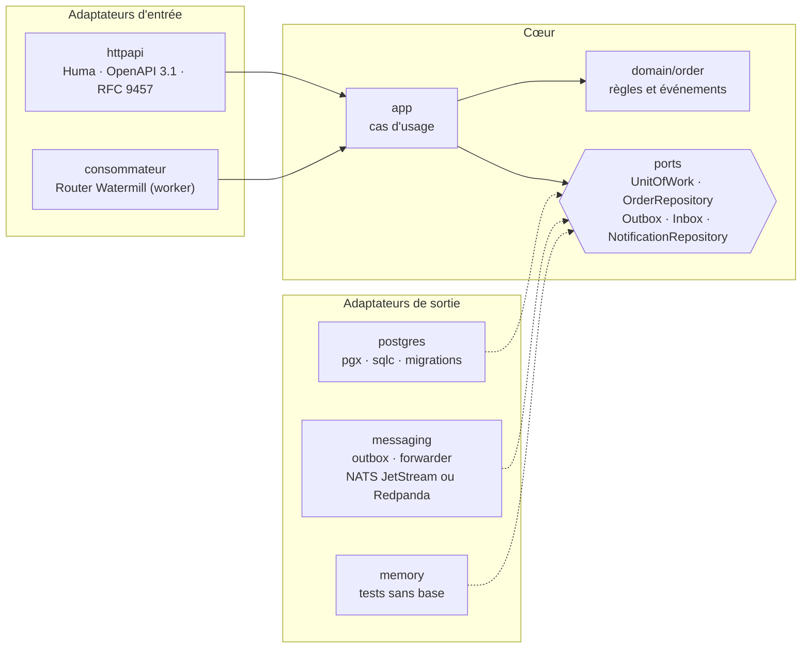
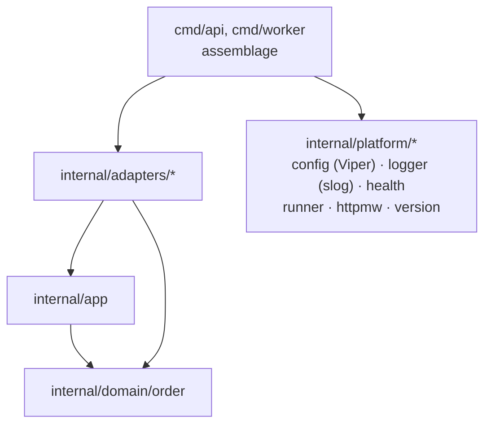

# Architecture hexagonale

Le domaine et les cas d'usage ne dépendent d'aucune technologie. Ils déclarent
des **ports** (des interfaces Go) ; les **adaptateurs** les implémentent, et les
binaires (`cmd/`) assemblent le tout à la main, sans conteneur d'injection.

Flèche pleine : « appelle ». Flèche pointillée : « implémente ». Le cœur ne
dépend d'aucune technologie : ni base, ni HTTP, ni messagerie.

**La règle des dépendances** : les flèches pointent vers le cœur. `domain` ne
connaît rien ; `app` ne connaît que `domain` ; les adaptateurs connaissent
`app` et `domain`, jamais l'inverse. Changer de base, de broker ou de
framework HTTP ne touche que les adaptateurs.

