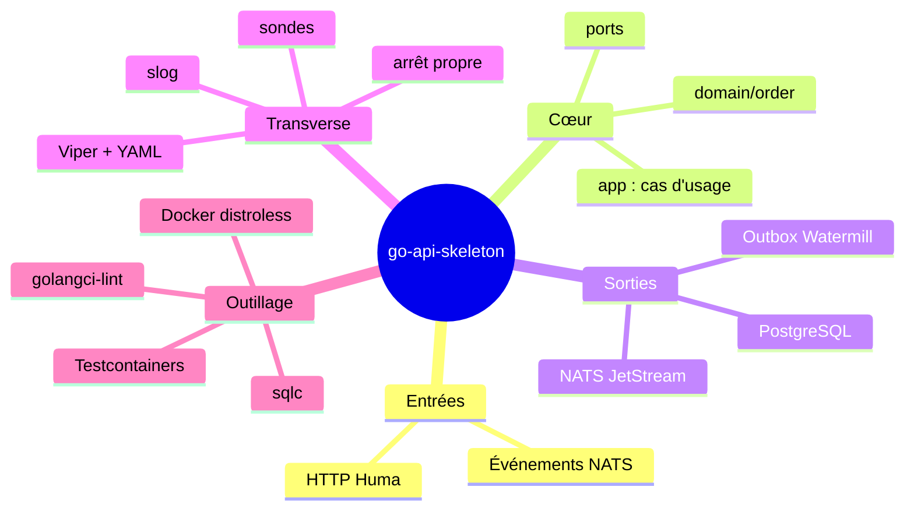

# Organisation du code

```text
go-api-skeleton/
├── cmd/
│   ├── api/                 binaire HTTP + forwarder de l'outbox
│   └── worker/              binaire consommateur d'événements
├── internal/
│   ├── domain/order/        règles métier, événements (aucune dépendance)
│   ├── app/                 cas d'usage et ports
│   │   └── apptest/         tests de contrat des ports (mémoire, PostgreSQL)
│   ├── adapters/
│   │   ├── httpapi/         API Huma : routes, DTO, erreurs RFC 9457
│   │   ├── postgres/        pgx, migrations/, queries/, db/ (généré par sqlc)
│   │   ├── messaging/       CloudEvents, outbox, forwarder, NATS JetStream
│   │   └── memory/          implémentation en mémoire des ports
│   ├── platform/            config, logger, health, runner, httpmw, version
│   └── testenv/             conteneurs des tests d'intégration
├── api/openapi.yaml         contrat HTTP, généré et vérifié
├── configs/                 api.yaml, worker.yaml (surchargés par l'environnement)
├── assets/                  ces schémas
├── compose.yaml             PostgreSQL, NATS, Jaeger (+ profil apps)
├── Dockerfile               une image par binaire (distroless, non root)
└── Makefile                 make help
```


