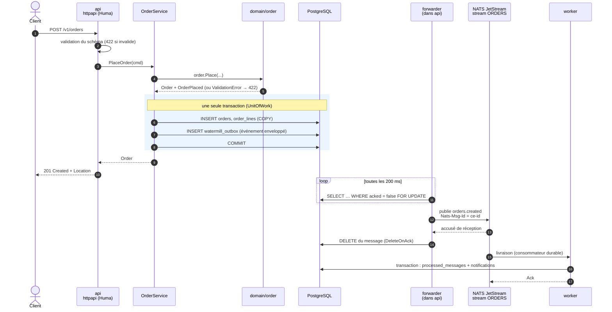

# Créer une commande : de la requête HTTP au worker

La commande et son événement sont écrits **dans la même transaction** : un
événement n'est publié que si la commande existe, et il n'est jamais perdu.
La publication est ensuite **asynchrone** : l'API répond sans attendre NATS.

**Si NATS est indisponible** : les étapes 1 à 10 fonctionnent normalement, le
client reçoit 201 ; l'événement attend dans `watermill_outbox`, et le
forwarder le publie au retour de NATS. `/health/ready` signale la coupure.

**Si l'API s'arrête entre la publication et l'effacement** : le message est
publié une seconde fois au redémarrage ; JetStream l'élimine, car il connaît
déjà son `Nats-Msg-Id` (fenêtre de déduplication de 2 minutes).
