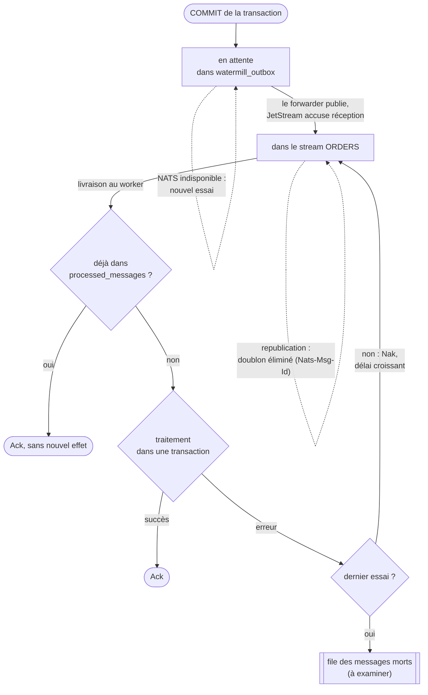

# Cycle de vie d'un message

La messagerie garantit une livraison **au moins une fois** : un message peut
arriver deux fois. Chaque étape est donc conçue pour le supporter.



| Garantie | Mécanisme |
|----------|-----------|
| Aucun événement perdu | outbox dans la transaction des données |
| Aucun événement fantôme | annuler la transaction annule l'événement |
| Pas de doublon dans le stream | `Nats-Msg-Id` + fenêtre de déduplication JetStream |
| Pas de double effet | `processed_messages` dans la transaction du traitement |
| Pas de blocage par un message invalide | essais limités, puis file des messages morts |

## Les essais du worker

| Erreur | Traitement |
|--------|------------|
| définitive (message illisible, type inconnu) | aucun essai : DLQ directement |
| passagère (base indisponible…) | `consumer.retries` essais rapides dans le processus, puis `Nak` : JetStream relivre après `consumer.backoff` (1 s, 5 s, 30 s, 2 min) |
| persistante | après `consumer.max_deliveries` livraisons : DLQ (stream `DLQ`, sujet `dlq.notifications`, raison dans l'en-tête `reason_poisoned`) |
| panique | `Recoverer` la transforme en erreur, traitée comme ci-dessus |

Le consommateur durable a un nombre de livraisons illimité côté JetStream :
c'est le worker qui décide d'envoyer en DLQ, aucun message n'est abandonné en
silence.

## Le format d'un message (CloudEvents, mode binaire)

```text
Sujet NATS : orders.created
En-têtes   : ce-specversion: 1.0
             ce-id:          0193a1c2-…          (= Nats-Msg-Id)
             ce-type:        order.created.v1    (version dans le type)
             ce-source:      go-api-skeleton/orders
             ce-subject:     <identifiant de la commande>
             ce-time:        2026-11-21T14:05:09Z
             content-type:   application/json
Corps      : {"order_id": "…", "customer": "…", "total_cents": 2500, "lines": […], "placed_at": "…"}
```
