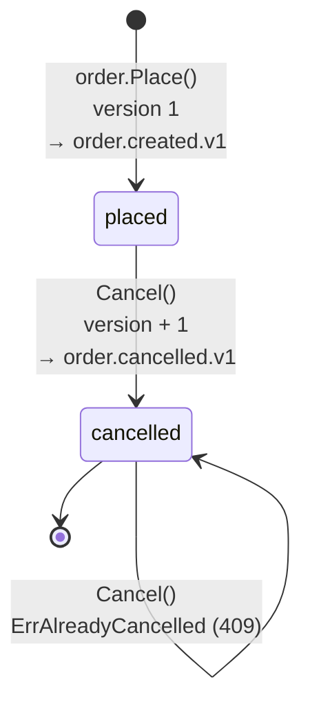
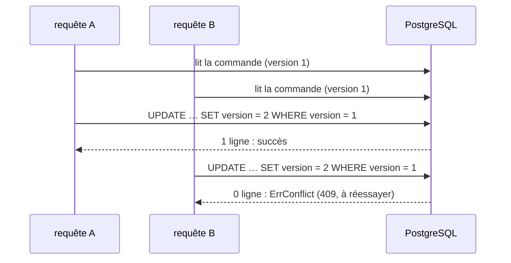

# États d'une commande

Chaque modification incrémente la **version**. La base n'accepte la mise à
jour que si elle contient encore la version précédente : deux annulations
simultanées ne peuvent pas réussir toutes les deux (verrou optimiste).

