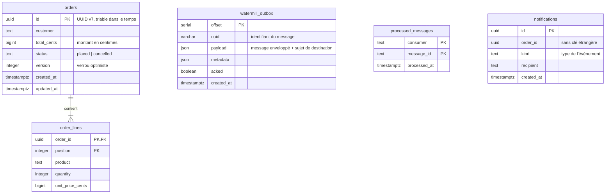

# Base de données

Le schéma est créé par les migrations embarquées dans le binaire
(`internal/adapters/postgres/migrations`), et lu par sqlc pour générer les
requêtes typées.

- `watermill_outbox` est la table de l'outbox : les lignes y restent le temps
  de leur publication (supprimées ensuite).
- `processed_messages` et `notifications` appartiennent au worker. Elles n'ont
  pas de clé étrangère vers `orders` : dans un vrai système, le worker aurait
  souvent sa propre base.
