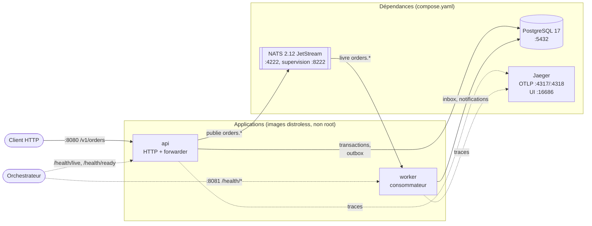

# Exécution

| Commande | Effet |
|----------|-------|
| `make up` | démarre PostgreSQL, NATS et Jaeger, et attend qu'ils soient prêts |
| `make run-api`, `make run-worker` | lance un binaire avec `configs/<binaire>.yaml` |
| `docker compose --profile apps up` | lance aussi les deux applications, depuis le Dockerfile |
| `make images` | construit les deux images |

**La configuration** : valeurs par défaut du code, puis `configs/<binaire>.yaml`,
puis variables d'environnement (`HTTP_ADDRESS` surcharge `http.address`).

| Sonde | Répond 200 si… | Sinon |
|-------|----------------|-------|
| `/health/live` | le processus répond | l'orchestrateur le redémarre |
| `/health/ready` | PostgreSQL et NATS répondent, et l'arrêt n'a pas commencé | 503 : retiré du trafic, sans redémarrage |
